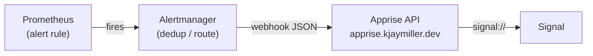
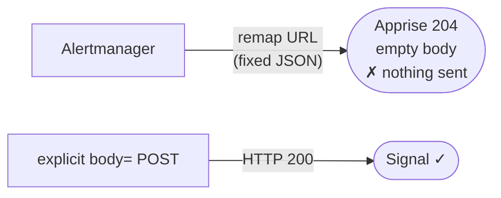
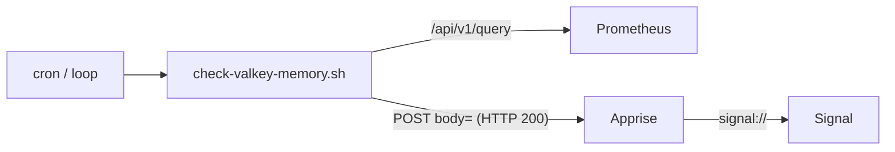

# Getting a Signal ping when Valkey runs low on memory

*How we turned Prometheus metrics into an actual alert — and why the "correct"
Alertmanager setup lost to a 30-line shell script.*

## The goal

[Last time](prometheus-metrics-for-valkey.md) we wired Crab Racing's Aiven
Valkey into Prometheus. Metrics you never look at are just a disk bill, so the
real point was always the next step: **tell me on Signal when available memory
drops to 75% or below**, before the leaderboard starts evicting keys.

The metric was already there. Prometheus scrapes `mem_available_percent` off the
Valkey instance every 30 seconds. All we needed was to watch it and send a
message.

## The textbook path: Prometheus → Alertmanager → Apprise → Signal

Prometheus doesn't send notifications itself. It evaluates *rules* and hands
firing alerts to **Alertmanager**, which dedups, groups, and routes them to a
receiver. So the canonical design is a four-hop chain:



The alert rule is straightforward:

```yaml
- alert: ValkeyLowMemoryAvailable
  expr: mem_available_percent{job="aivenmetrics"} <= 75
  for: 5m                       # ride out brief dips before paging
  annotations:
    summary: "crab-race-valkey memory available at {{ $value | printf \"%.1f\" }}%"
```

The catch is the third hop. My homelab already runs
[Apprise](https://github.com/caronc/apprise-api) as the fan-out to Signal — but
**Apprise doesn't understand Alertmanager's webhook JSON**. Alertmanager sends a
fixed blob (`{"commonAnnotations": {...}, "alerts": [...]}`); Apprise wants a
flat `body` and `title`. Apprise's documented answer is its *third-party webhook
remap* — colon-prefixed query params that pluck fields out of an arbitrary
payload:

```
/notify?urls=signal://...&:commonAnnotations.description=body&:commonAnnotations.summary=title
```

On paper, that closes the gap. I built the whole chain — rule, Alertmanager
config rendered from a template, a `prom/alertmanager` container in
`docker-compose.yml` — and fired a test alert.

## Nothing arrived

The alert fired. Alertmanager showed it `active`, routed to the receiver. And…
no Signal message.

The tell was in the HTTP status. Every request through the remap URL came back
**`204 No Content`** — Apprise-speak for *"I accepted this and sent nothing,
because there was no body."* Meanwhile a plain request with an explicit body:

```bash
curl -X POST https://apprise.kjaymiller.dev/notify \
  --data-urlencode "urls=signal://..." \
  --data-urlencode "body=control-check"
# -> HTTP 200,  logs: "Sent 1 Signal API notification"
```

…landed on my phone instantly. So Signal delivery worked. The **field remap**
was the broken link. I tested it every way the docs describe — nested
dot-notation, a static `:body=` fix-value, the exact worked example from
Apprise's own README — and every single one returned 204. This server is Apprise
API **v1.3.3**; the remap feature it needs either postdates that build or is
disabled. On *this* server, it simply doesn't fire.



That reframed the problem. Alertmanager can *only* emit its fixed JSON blob — it
had no way to produce the flat `body=` that this Apprise server actually
requires. The fancy hop was structurally incapable of talking to the endpoint I
have.

## The path of least resistance

Earlier in this whole exercise I'd asked myself whether Alertmanager even needed
to be its own container. Turns out the answer was no — and the thing that killed
it was the same 204.

If the only delivery method that works is "POST a plain body," then I don't need
a component whose entire job is routing a JSON shape Apprise can't parse. I can
query Prometheus directly and send the message myself:



The whole thing is one shell script on a timer. It asks Prometheus for the
current value, compares it to the threshold, and — if it's over — sends the
notification through the code path we *proved* works:

```bash
avail="$(curl -s --get "$PROM_URL/api/v1/query" \
  --data-urlencode 'query=mem_available_percent{job="aivenmetrics"}' \
  | python3 -c "import sys,json;r=json.load(sys.stdin)['data']['result'];print(r[0]['value'][1] if r else '')")

# ...if avail <= threshold:
curl -s -X POST "$APPRISE_BASE/notify" \
  --data-urlencode "urls=$sig" \
  --data-urlencode "title=crab-race-valkey low memory" \
  --data-urlencode "body=Available memory is ${pct}% (threshold ${THRESHOLD}%)." \
  --data-urlencode "type=warning"
```

Alertmanager gives you `for: 5m` debounce, dedup, grouping, and "resolved"
notices for free. Drop it and you own those. For a homelab with **one** alert
that's a cheap bill: a tiny state file in `/tmp` records whether we're already
firing and when we last notified, which buys back the two behaviors that
actually matter —

- **debounce / renotify:** notify once, then stay quiet until a renotify window
  (3h) elapses, instead of every single run;
- **recovery:** send one "recovered" note when memory climbs back over the line.

The Signal URL still carries a phone number, so — same rule as the scrape
password before it — it's read from [fnox](https://github.com/jdx/fnox) at send
time and never written into the repo.

## What each run looks like

```
$ THRESHOLD=85 ./scripts/check-valkey-memory.sh
FIRING: 79.4% available -> Signal notify HTTP 200

$ ./scripts/check-valkey-memory.sh          # still low, within window
FIRING but within renotify window; staying quiet (79.4% available)

$ ./scripts/check-valkey-memory.sh          # climbed back
RECOVERED: 79.4% available -> Signal notify HTTP 200

$ ./scripts/check-valkey-memory.sh          # steady
OK: 79.4% available (>75%)
```

Every `HTTP 200` is a message that actually reached my phone — verified, not
assumed.

## The lesson: test the last hop first

The Alertmanager design wasn't *wrong*. It was wrong **for this endpoint**, and I
found that out only by watching status codes — a `204` that looks like success
until you know it means "sent nothing." If I'd sent one plain `body=` POST to
Apprise on day one, I'd have learned the server's shape before building a routing
layer around a feature it doesn't support.

Match the tool to the endpoint you actually have, not the one the tutorial
assumes. Sometimes the reference architecture is a container you get to delete.

---

*The metrics side of this — the Prometheus scrape, the plan bump, keeping
credentials out of git — is in
[the previous post](prometheus-metrics-for-valkey.md).*
