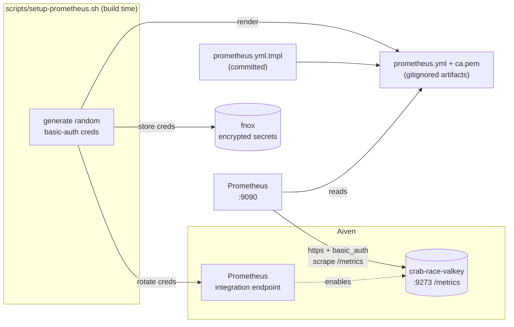
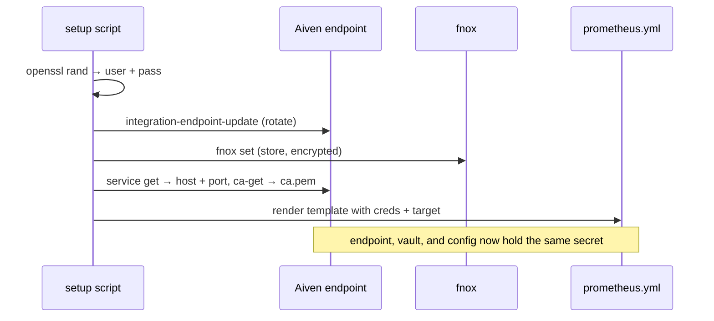

# Watching Valkey with Prometheus without leaking the password

*How we wired Crab Racing's Valkey into Prometheus, and why the credentials are
generated at build time instead of living in the repo.*

## The setup

Crab Racing leans on [Valkey](https://valkey.io/) for two things now: the
ephemeral leaderboard and a cross-instance rate limiter. Both are on the hot
path of a real-time game, so when something gets slow or starts evicting keys,
we want to *see* it: memory pressure, connected clients, commands per second,
keyspace hits and misses.

Our Valkey runs on [Aiven](https://aiven.io/), and Aiven can expose every
service's internal metrics over a Prometheus endpoint. So the plan is short:
turn on the integration, point a Prometheus at it, done. The interesting part
turned out not to be the wiring. It was two things the happy-path docs don't
dwell on: the plan tier, and where the scrape password lives.

At a glance, here's the shape we landed on. One script keeps the Aiven endpoint
and the local secret store in lockstep, and Prometheus scrapes with credentials
it never had to have committed:



## The first wall: metrics aren't a hobbyist feature

The [Aiven Prometheus integration](https://aiven.io/docs/platform/howto/integrations/prometheus-metrics)
is two moves: create a Prometheus *integration endpoint* (this holds the
basic-auth credentials Prometheus will use), then enable that endpoint on the
service you want to scrape.

The endpoint created fine. Enabling it on the Valkey service came back with:

```
Error: Service integration prometheus is not available for this service (status 403)
```

That 403 reads like a permissions problem. It isn't. Our Valkey was on the
**hobbyist** plan, and metrics integrations start at the **startup** tier. The
fix was a one-line plan bump:

```bash
avn service update --project <project> crab-race-valkey -p startup-4
```

The service goes into `REBALANCING` for a few minutes while it resizes, comes
back `RUNNING`, and *then* the integration enables without complaint. Worth
knowing before you go hunting through IAM for a permission that was never the
problem.

## Where the scrape password lives

Enabling the integration hands you a scrape config that looks like this:

```yaml
scrape_configs:
  - job_name: aivenmetrics
    scheme: https
    basic_auth:
      username: <PROMETHEUS_USERNAME>
      password: <PROMETHEUS_PASSWORD>
    tls_config:
      ca_file: ca.pem
    static_configs:
      - targets: ["<HOST>:9273"]
```

That `password` is a real credential. Drop it into a `prometheus.yml` and commit
the file, and you've published a secret to git history forever. This is the
oldest trap in the book, and it's easy to walk into because the config file
*wants* the literal value sitting right there.

So we don't commit the config. We commit a template with placeholders. This is
the file that lives in git:

```yaml
# prometheus/prometheus.yml.tmpl  (committed — no secrets)
scrape_configs:
  - job_name: aivenmetrics
    scheme: https
    basic_auth:
      username: ${PROMETHEUS_BASIC_AUTH_USERNAME}
      password: ${PROMETHEUS_BASIC_AUTH_PASSWORD}
    tls_config:
      ca_file: /etc/prometheus/ca.pem
    static_configs:
      - targets: ["${PROMETHEUS_SCRAPE_HOST}:${PROMETHEUS_SCRAPE_PORT}"]
```

The real `prometheus.yml`, with those four `${...}` slots filled in, is
generated at build time and never checked in.

## The build-time script

`scripts/setup-prometheus.sh` runs whenever you stand the stack up (or want to
rotate credentials). Every run it:

1. **Generates fresh random basic-auth credentials.** The username has to match
   Aiven's `^[a-z0-9\-@_]{5,32}$`, so we mint something like
   `cprom$(openssl rand -hex 6)`; the password is 24 random chars.
2. **Rotates them onto the Aiven endpoint** with
   `avn service integration-endpoint-update`. The credentials Prometheus will
   present and the credentials Aiven expects are updated in the same breath, so
   they can't drift.
3. **Stores them in [fnox](https://github.com/jdx/fnox)** (encrypted), so the
   secret never touches shell history, the repo, or CI logs.
4. **Resolves the scrape target and downloads the project CA.** The port
   (`9273`) comes straight off the endpoint's `endpoint_config.client_port`; the
   host comes from the service's `prometheus` component, which only appears once
   the integration is active. The CA lands at `prometheus/ca.pem`.
5. **Renders `prometheus/prometheus.yml`** from the committed
   `prometheus.yml.tmpl`, substituting the credentials and target at render time.

Those five steps are one atomic-feeling flow: the same generated pair goes to
Aiven, to fnox, and into the rendered config, so nothing can drift out of sync:



The template is the only file in `prometheus/` we track. The rendered
`prometheus.yml` and `ca.pem` are gitignored. They're build artifacts,
regenerated on demand, never committed:

```gitignore
# Generated Prometheus config — contains basic-auth credentials.
# ca.pem is already covered by the *.pem rule above.
prometheus/prometheus.yml
```

Rotating the scrape password is just re-running the script: new creds, pushed to
Aiven, re-rendered locally, and the old ones are dead.

A small papercut worth recording: the render started as
`string.Template(...).substitute()`, which chokes on the `${...}` that appears
in the template's own explanatory comment. `safe_substitute()` leaves unknown
`$` sequences alone and fixes it.

## The scraper itself

Prometheus is just another service in `docker-compose.yml`, mounting the two
generated files read-only:

```yaml
  prometheus:
    image: prom/prometheus:latest
    ports:
      - "9090:9090"
    volumes:
      - ./prometheus/prometheus.yml:/etc/prometheus/prometheus.yml:ro
      - ./prometheus/ca.pem:/etc/prometheus/ca.pem:ro
```

Run the setup script, `docker compose up -d prometheus`, and the UI is at
`localhost:9090`. The proof it works is the `up` metric:

```
up{job="aivenmetrics"} = 1
```

`1` means Prometheus authenticated, trusted the TLS cert, and scraped
successfully. Hundreds of Valkey series (memory, clients, commands, keyspace)
now land every 30 seconds.

## Templates in git, secrets in a vault

The whole shape of this comes down to one habit: the repo describes the
config; it never contains the credential. A committed template plus a
build-time generator gives you a config that's reproducible on any machine,
rotatable in one command, and impossible to leak by `git add`. The endpoint on
Aiven and the copy in fnox stay in lockstep because the same script writes
both.

Turning on metrics was the easy part. Turning them on *without* scattering a
password across the repo is the part worth doing deliberately.

---

*The Valkey that we're now watching is the same one behind the
[leaderboard rate limiter](rate-limiting-with-valkey.md).*
